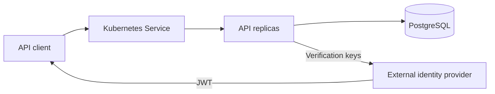

# VaultCore architecture

One stateless Java 21 / Spring Boot 4.1.1 application, one PostgreSQL database,
and feature modules for accounts, transactions, ledger, and security.



## Boundaries and data

Controllers validate records/DTOs. AccountService uses JPA for account creation,
ownership-aware reads, and pagination. MoneyService uses JdbcTemplate for explicit
row locking and atomic posting; TransactionQueries reads immutable history.
LedgerService reconciles balance projections against postings in a repeatable-read
snapshot. Security validates JWTs and maps recognised role claims; services enforce
account ownership and operation permissions.

| Table | Purpose |
| --- | --- |
| accounts | Customer ownership/status, UGX balance projection, version; one internal clearing account |
| bank_transactions | Immutable operation, source/destination, amount, actor, persisted timestamp |
| ledger_entries | Two signed postings per transaction: negative source, positive destination |
| idempotency_records | Unique subject + operation + key, canonical request hash, immutable transaction reference |

Flyway V1 creates accounts; V2 adds the clearing account, transaction/ledger tables,
indexes, idempotency records, and database guards. Deferred constraint triggers
require exactly two matching balanced entries before commit. Row triggers reject
UPDATE/DELETE of transactions/postings. Customer balances have a nonnegative CHECK;
clearing may be negative. Reconciliation detects balance projection drift.

## Transaction algorithm

1. Validate amount/currency, key format, source/destination, and cash-operation role.
2. Enter a TransactionTemplate callback with a 10-second transaction timeout.
3. Claim a unique idempotency record using INSERT ON CONFLICT. A concurrent claim
   waits for the other transaction, then replays its immutable result or rejects a
   changed canonical fingerprint. Only successful requests retain a key.
4. Lock both accounts using SQL ORDER BY id FOR UPDATE, independent of direction.
   Check owner, status, currency, funds, and resulting numeric bounds under locks.
5. Debit and credit, increment versions, insert the transaction and both postings,
   and complete the idempotency reference in one database transaction.
6. Commit before returning; deferred guards validate the entire posting. Any error
   rolls back balances, postings, and key together. Retry transient failures at
   most three times, each in a new transaction; otherwise return 503.

Lock waits are capped at two seconds. No remote calls occur inside this transaction.
TransactionTemplate is the explicit boundary, so it does not rely on self-invocation
of @Transactional methods. JPA account/reconciliation services use external proxy
calls for their annotated boundaries. Idempotency records have no expiry policy.

## Identity and API rules

Normal mode validates an external issuer's RSA/JWK-backed JWT, audience, and time
claims. Customers create/read their own accounts and transfer from their own source
accounts. TELLER/ADMIN perform cash operations; privileged roles can read
customer accounts/history. AUDITOR/ADMIN can reconcile. Ownership comes from token
subject, not user-supplied account-owner fields. ADMIN can initiate transfers for
other accounts. Public health probes expose no details.

The explicit dev profile supplies a deliberately permissive local token endpoint.
Host Java processes bind to loopback; containers listen on their internal interface
with Docker publishing host ports only on loopback. Its generated RSA key is
process-local unless a PKCS8 key file is supplied. The CI-only patch
mounts a shared signing-key Secret so test tokens work across two replicas. This
profile is absent in normal deployments. The README lists the complete API contract.

## Runtime and deployment

Maven/tests reuse one 256 MB-heap JVM. Runtime has a 192 MB heap, bounded Tomcat
threads, three database connections, graceful shutdown, and ECS structured logs
in normal mode. X-Request-ID is propagated to responses/log context; payloads,
tokens, and SQL parameter values are not logged by application code.

The native dev runner builds first if requested, starts one private PostgreSQL
instance, runs the API, and stops both on exit while retaining application data.
The native test runner creates and removes an isolated database on a free port.
The multi-stage Dockerfile compiles source with JDK 21 and copies the application
JAR into a non-root JRE image. Docker builds exclude local secrets and generated
output. Compose runs the API and PostgreSQL on an internal network, waits for
database health before API startup, publishes ports on loopback, and retains a
named database volume. A readiness healthcheck reports API/database availability.
Direct Docker and host Java commands provide alternatives to the helper scripts.
Setup and default Maven verification do not launch application services.

Kubernetes has a Deployment/Service, external ConfigMap/Secret values, bounded
resources, non-root/read-only API containers, temporary storage, probes, and a
PostgreSQL StatefulSet/PVC. Startup and liveness use application state; readiness
also checks the database. The one-replica default permits update downtime; CI
uses two replicas with maxUnavailable=0/maxSurge=1. Neither supplies database HA.
Migrations are additive and must remain compatible with overlapping app versions.

## Recovery verification

On a disposable cluster, `scripts/k8s-smoke.sh` verifies money
operations and replay, restarts replicas, pauses/restores the database, deploys a
missing image, inspects events, rolls back, and verifies persisted state again.
It checks the kind-vaultcore context and uses private test authentication.

The complete project command reference, including manual API calls, deployment,
scaling, failure drills, storage behaviour, and cleanup, is in the
[README](../README.md#command-reference).

Common diagnostic commands:

```bash
kubectl get pods -o wide
kubectl describe pod <pod>
kubectl logs <pod>
kubectl logs <pod> --previous
kubectl get events --sort-by=.lastTimestamp
kubectl rollout status deployment/vaultcore
kubectl rollout undo deployment/vaultcore
```

For CrashLoopBackOff inspect previous logs, configuration, and database access.
For Pending inspect resource requests/storage events. For OOMKilled inspect the
last termination reason and JVM heap/metaspace/native memory against limits.
Database failures should remove readiness without causing liveness restart loops.

Kafka/outbox remains an optional extension: commit an event with the posting,
publish asynchronously, and deduplicate at-least-once delivery by event ID.
